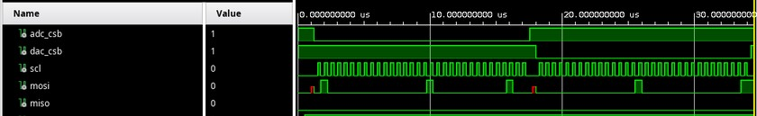

============
Verification
============

This device must, of course, be verified. One of the main goals of this project is to gain experience with UVM,
and so there will be three levels of verification.

1. Block-level testbench with ``cocotb`` and Verilator. This is to compare against the fixed-point math and Python modeling.
   From the repository root, ``make hdltest.<name>`` runs ``scripts/hdl_sim/test_<name>.py``
   (``MODULE=test_<name>``, ``SIM=verilator``). ``make hdltest.dac_datapath`` checks the
   ``dac_datapath`` skeleton (reset codes and ``dsm_locked``). It does not compare a waveform
   to the Python model. ``make hdltest`` runs every ``test_*.py`` there, and exits without a
   simulator when that directory has none.
2. System-level testbench with UVM. This ensures that the SPI interface can control the device as intended.
   It will also be used for randomized DAC outputs and ADC sampling. This will not check that SNR is correct,
   but should be able to check that the ADC sampling is a sine wave in the waveform viewer.
   UVM system tests are not part of ``hdltest``.
3. Validation testbench with ``pyserial``, Arduino, and Jupyter Notebook. Using PeakRDL, it should be possible
   to have an easy way of running ``set`` and ``write`` and ``read``, similar to UVM syntax.

System-Level Architecture
-------------------------

System-level verification for this device will be done with UVM, using a combination of AXI and SPI.
The goal is to drive stimulus using an agent to gain confidence that the RTL will work, and repurpose a
SPI agent to check the buses for shift registers and DACs.

ADC Testbench
~~~~~~~~~~~~~

The ADC testbench is meant as a learning opportunity for UVM and also for a thorough testbench for the ADC RTL.
Unlike a real tapeout, we can recompile, but I'd rather not.

.. image:: ./_static/img/uvm_tb.png
   :alt: Digital Testbench
   :align: center

AXI Integration Testbench
~~~~~~~~~~~~~~~~~~~~~~~~~

If possible, I will integrate this with the Zynq PS such that this can be run similar to PYNQ.
In that case, an AXI to SPI adapter will be necessary, and will be run like so:

The first thing to do will be to add an AXI adapter so that it can be used to communicate with
both the DAC and the ADC.

.. image:: ./_static/img/axi_integration_tb.png
   :alt: AXI to SPI
   :align: center

Writing Tests
-------------

The ADC and DAC are connected to the toplevel ``regmodel`` instance. With that scheme, the tests are portable
to the single-AXI-bus scheme. If a single AXI interface is eventually possible, then the same scheme would be used.

The reset and clock agents can be set using each one's ``set`` method. Registers can be written using the toplevel
``regmodel`` instance.

.. code-block:: systemverilog

   class reg_rw_test extends base_test;

       `uvm_component_utils(reg_rw_test)

       function new (string name = "reg_rw_test", uvm_component parent = null);
           super.new(name, parent);
       endfunction

       virtual task main_phase(uvm_phase phase);
           uvm_sequencer_base   sequencer;
           uvm_status_e         status;

           phase.raise_objection(this);

           `uvm_info(get_full_name(), "Beginning main phase", UVM_LOW)

           regmodel.ADC.SH_CTRL.write(status, 16'h4004);
           regmodel.DAC.ENABLE.dacp_enable.write(status, 1'b1);

           phase.drop_objection(this);
       endtask

   endclass

These register transactions are executed on two different agents, on two different interfaces, which act on some shared pins.

Test List and Status
--------------------

+--------+--------------+--------------------------------------------------+
| Test                  | Description                                      |
+========+==============+==================================================+
| DAC    | ``test_dc``  | Test that DC values are set, once                |
+--------+--------------+--------------------------------------------------+
| DAC    | ``test_ac``  | Test that AC values run CORDIC, no DSM           |
+--------+--------------+--------------------------------------------------+
| DAC    | ``test_dsm`` | Test that noise is shaped correctly              |
+--------+--------------+--------------------------------------------------+
| ``test_reg_rd``       | Test that registers can be read with reset       |
+--------+--------------+--------------------------------------------------+
| ``test_reg_wr``       | Test that registers can be written if necessary  |
+--------+--------------+--------------------------------------------------+
| ``test_reg_buff``     | Test that double-buffered registers are updated  |
|                       | only when necessary                              |
+--------+--------------+--------------------------------------------------+
| ``test_dac_outputs``  | Randomize DAC registers, observe output          |
+--------+--------------+--------------------------------------------------+
| ``test_adc_nfft``     | Randomize ADC registers, check number of outputs |
+--------+--------------+--------------------------------------------------+
| ``test_adc_settling`` | Randomize ADC registers, check delay for each    |
|                       | stage of SAR state machine.                      |
+--------+--------------+--------------------------------------------------+
